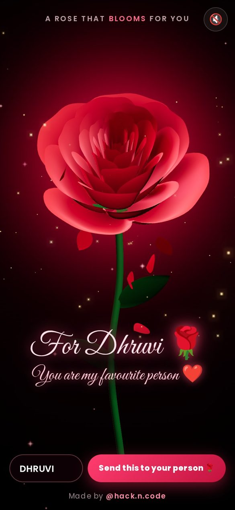

# 🌹 A Rose That Blooms For You

A 3D rose that blooms petal by petal, built from **one parametric equation** with HTML, CSS, JavaScript and [Three.js](https://threejs.org). No 3D models, no images.

**▶ Live demo: https://rose-hackncode.sites.tab.bot/**

Personalised link: https://rose-hackncode.sites.tab.bot/?name=DHRUVI



## What it does
- 🌱 Starts as a glowing closed bud
- 👆 Tap it: the petals unfold **one by one** into a full red rose
- ✨ Golden sparkles rise and a few petals drift down
- ✍️ A handwritten message types itself under the rose
- 💌 Type their name and tap **Send this to your person**: it copies (or shares) your personal link
- 🔇 Sound is off by default; tap the speaker for a soft music-box melody

## Make it yours
| Link | Shows |
|---|---|
| `?name=DHRUVI` | "For Dhruvi 🌹 / You are my favourite person ❤️" |
| `?msg=Will%20you%20be%20mine%3F` | your own message |
| `?name=RIYA&msg=Happy%20Birthday` | both |

## The math
Every petal comes from one surface. `x` runs from a petal's base to its edge and `t` winds around the spiral:

```js
const p = PI / 2 * exp(-t / (8 * PI));                  // how far each petal leans out
const u = 1 - (1 - (3.6 * t % TAU) / PI) ** 4 / 2;      // petal outline
const y = 2 * (x * x - x) ** 2 * sin(p);
const r = u * (x * sin(p) + y * cos(p));
const h = u * (x * cos(p) - y * sin(p));
position = [r * cos(t), h, r * sin(t)];
```
Blooming is just animating `p` from a closed bud to the open value, outer petals first.

## Run locally
```bash
git clone https://github.com/hackncode1020/rose-25-10-26
cd rose-25-10-26
python3 -m http.server 8000   # open http://localhost:8000
```

## Files
- `index.html`: page and UI
- `style.css`: dark romantic styling
- `rose.js`: the rose surface, bloom, sparkles, falling petals, message and sound

Made with ❤️ by **[@hack.n.code](https://instagram.com/hack.n.code)**. Comment **ROSE** on the reel for more!
